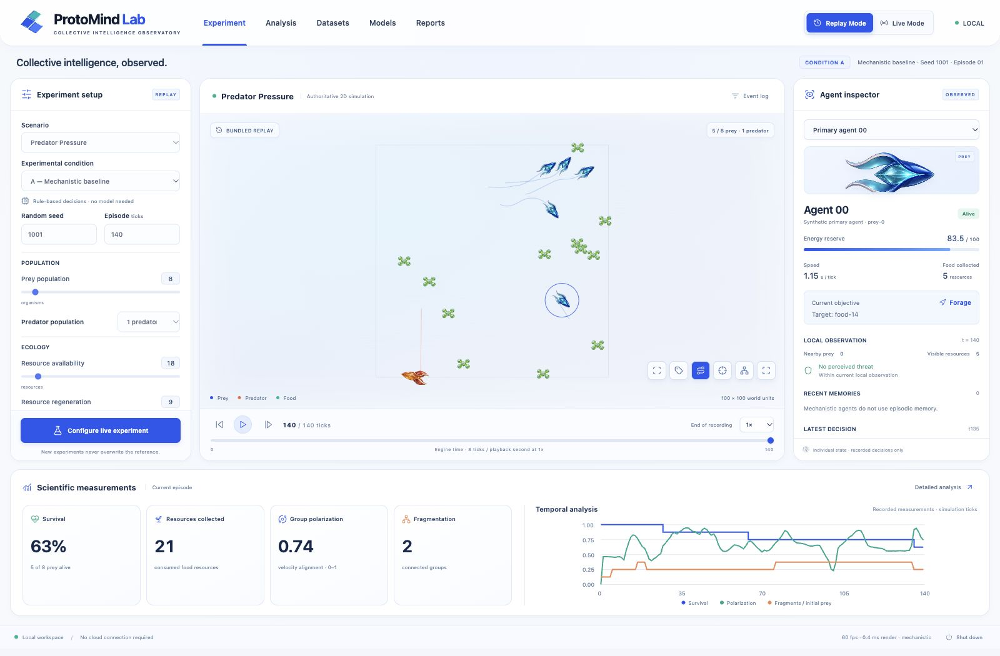
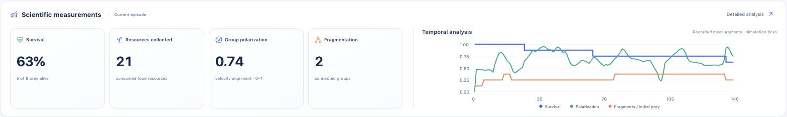
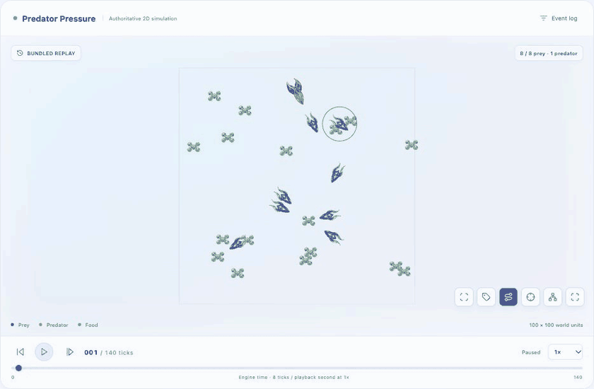
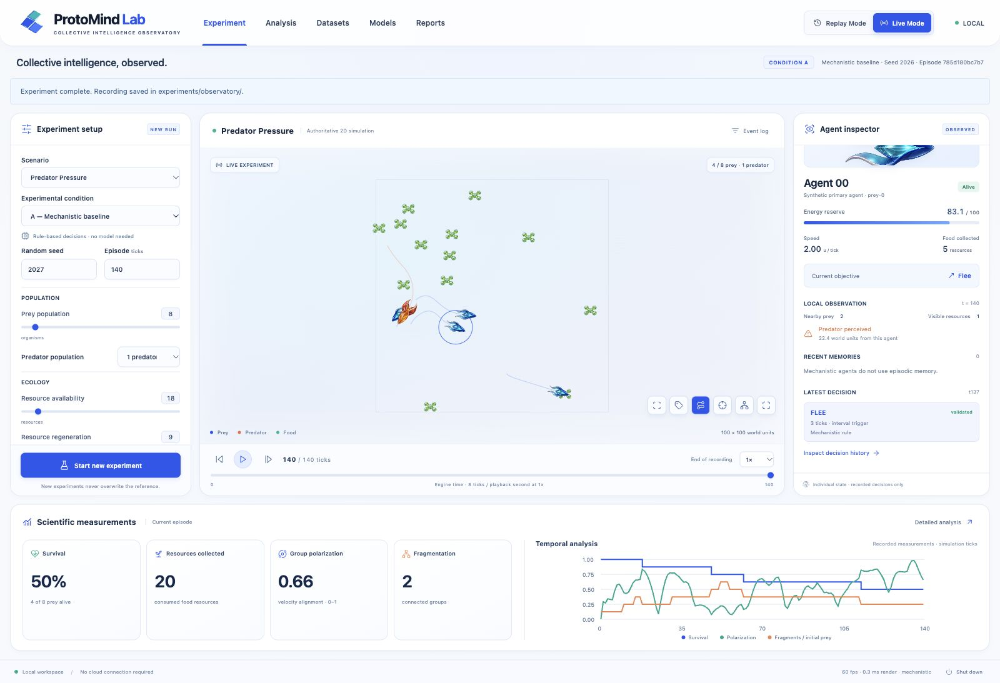

<p align="center"></p>

# ProtoMind Lab

A local research environment for studying how small language models, individual episodic memory, and partial observations influence collective agent behavior under resource constraints and predation pressure.

ProtoMind Lab separates behavioral decisions from physical dynamics. Independent agents observe a bounded neighborhood, optionally retrieve their own memories, and request a structured objective from a shared local language model. A deterministic simulation engine applies that objective through constrained movement and ecological rules. The interactive observatory exposes the resulting trajectories, observations, decisions, events, and measurements for inspection and reproducible comparison.








*Recorded engine frames from the bundled Predator Pressure experiment: condition A, mechanistic policy, seed 1001, eight initial prey agents, and one predator. No language-model inference is used in this animation. The GIF shows ticks 1–80 at eight recorded ticks per second (10 seconds). It uses actual browser-rendered frames and does not change simulation dynamics.*

## Research scope and architecture

The research question is whether model-mediated objectives, and then individual memory, alter resource use, survival, or collective motion relative to a mechanistic baseline. Agents share model weights but have separate observations and memory namespaces. The project does not train model weights or establish that emergent intelligence, learning, or biological realism has been achieved.

The decision loop is:

**Local observation → optional individual memory → behavioral policy → structured-decision validation → mechanistic steering → world update → recorded measurements.**

The Python engine owns position, velocity, acceleration limits, turning constraints, energy, resources, and capture events. The TypeScript/PixiJS interface renders those states at a separate display rate. Synthetic blue agents, coral pressure agents, and green resource clusters are visual representations; their shading introduces no simulated depth.

One loopback-only llama.cpp process serves model requests sequentially. A project-level lock prevents simultaneous model loads by cooperating project processes. The default integration is Liquid AI's LFM3-1.7B GGUF. Replay and mechanistic experiments require no model or inference runtime.

## Experimental conditions

| Condition | Decision mechanism | Memory supplied to the policy |
| --- | --- | --- |
| A | Deterministic mechanistic baseline | None |
| B | Local language model | Current observation only |
| C | The same local language model | Agent-specific episodic memory |
| D | The same local language model | The existing scrambled-content memory control |

Condition D preserves record structure while scrubbing content; it is not a permutation of authentic memories between agents. The interface retains the established “shuffled-memory control” label. See the [experimental protocol](docs/experimental_protocol.md) and [scientific model](docs/scientific_model.md) for exact definitions.

Decisions choose an objective, duration, and optional visible target. Invalid or unavailable model responses use the engine's explicitly recorded safe fallback; they are counted as invalid decisions and are not presented as successful inference. Model-load or compatibility failure prevents a model-based episode from starting. The CLI's explicit mock backend is a software test double and is never evidence about LFM3.

## Interactive observatory

The application starts in a bundled, verified replay. Transport controls support play, pause, speed changes, single-tick steps, seeking, and event navigation. Select an agent in the arena or inspector to examine actual state and recorded decisions. Optional overlays show recorded trails, sensing radii, predator sensing fields, and neighbor links.

Live mode exposes population, seed, episode length, resources, regeneration, perception, pursuit, decision scheduling, and memory bounds. The calibrated reference preset is immutable. The engine supports 1–100 prey and 0–1 predator; visual examples never add unrecorded organisms. Advanced parameters remain constrained by backend validation.



Analysis displays observed measurements and descriptive comparisons between local recordings. Reports save JSON and CSV under the project. Single episodes and unmatched configurations do not establish treatment effects. In the model-free inspector screenshot, the memory section correctly states that condition A has no episodic memory; no synthetic memory entries are shown.

## Installation and quick start

Requires **Python 3.10 or newer**. macOS is the primary desktop target; Unix-like systems can use the browser interface. Native Windows operation is not currently supported. The included production web build avoids a mandatory Node.js installation for normal use.

From the downloaded project directory:

```sh
./scripts/setup.sh
./scripts/observatory.sh --open
```

Open the printed loopback URL if the browser does not open automatically. The default address is `http://127.0.0.1:8765`; use `--port 8766` if that port is occupied. Basic setup creates a project-local virtual environment and does not download models or Python runtime packages. Once Python and the project are available, replay and condition A work without an internet connection.

On macOS, double-click **Launch ProtoMind Lab.command** for browser startup. To build the native WebKit launcher, install Apple's Command Line Tools and run:

```sh
./scripts/build_macos.sh
```

Then open **ProtoMind Lab.app** inside the project directory. Keep it beside `scripts/`, `web/`, and `assets/`; move the whole project when relocating it. The launcher owns its Python process and requests shutdown when its window closes. It reuses the project's model directory. The build is ad-hoc signed, not notarized; Gatekeeper behavior on a newly downloaded machine is not guaranteed. See [installation and desktop packaging](docs/installation.md).

Stop browser mode with the application's **Shut down** command or Ctrl-C in its terminal. Closing a browser tab alone does not stop an independently launched server.

## Models and experiments

Model installation is an explicit, optional step:

```sh
./scripts/setup.sh --runtime
./scripts/download_model.sh
```

The download script retrieves the pinned official LFM3-1.7B Q4_K_M file, checks its publisher SHA-256, and reuses an existing valid file. The download is approximately 1.1 GB. No credentials or external inference API are required. Model weights are not distributed here.

The **Models** panel lists project-local GGUF files, metadata, quantization filenames, context settings, estimated memory, and available disk space. Import copies a selected file into `models/` and deduplicates identical content. Embedded chat templates, model loading, and observation-constrained structured responses are tested; support is limited to models compatible with the installed runtime and decision interface. A different GGUF architecture is not automatically compatible.

To conduct an interactive experiment, choose **Live Mode**, a scenario and condition, edit parameters, then start. Mechanistic condition A remains available if no model is installed. The CLI supports paired-seed studies and parameter sweeps; see the [usage guide](docs/usage.md).

## Reproducibility and verification

The bundled recording contains 141 frames, including the initial state, and is approximately 112 KiB compressed. It is condition A, seed 1001. `recordings/manifest.json` records its checksum and provenance. The test suite reapplies its decisions and compares engine positions, events, and metrics.

```sh
./scripts/run_tests.sh
PROTOMIND_HTTP_TEST=1 ./scripts/run_tests.sh
# Optional, only after installing the real model and runtime:
PROTOMIND_REAL_TEST=1 ./scripts/run_tests.sh
```

For frontend development, use a supported Node.js version and the pinned pnpm lockfile; follow the [development guide](docs/development_guide.md). A seed alone does not guarantee identical future model output. Recorded validated action sequences provide engine replay independently of the model. Inference latency and rendering performance are environment-dependent.

The test commands above separate model-free checks from optional real-model checks. A replay or a short pilot is not evidence of a memory advantage.

## Scientific foundations and limitations

The movement system draws on Reynolds' [distributed flocking model](https://doi.org/10.1145/37401.37406) and collective-motion research such as Couzin et al.'s [effective leadership study](https://pubmed.ncbi.nlm.nih.gov/15690039/). These references motivate model structure; they do not validate this implementation against empirical trajectories.

The environment uses simplified steering, clamped boundaries, point resources, and finite sensing. The predator has no satiation dynamics and may capture at most one prey per tick. Model objectives are language-mediated policies, not demonstrated cognition. Memory is external episodic storage, not weight learning. Small samples, model selection, prompt construction, fallback frequency, and ecological parameters can all affect interpretation. See [limitations](docs/limitations.md) and the [research design](docs/research_design.md).

## Privacy, storage, and licensing

There are no accounts, subscriptions, telemetry, cloud inference, or remote runtime assets. Application-managed models, caches, databases, recordings, logs, and build outputs stay under the project. Operating-system swap, browser behavior, and toolchain metadata are outside that guarantee.

This source distribution excludes model weights, inference binaries, virtual environments, `node_modules`, private experiment data, logs, and Git history. Run `./scripts/prepublish_check.sh --source-only` before sharing a source archive; use the normal audit after initializing a repository. The explicit [publication manifest](publication-manifest.json) inventories distributable files. See [privacy and publication controls](docs/privacy_and_storage.md).

The existing [MIT license](LICENSE) and author notice are preserved. The original project documentation asks the owner to confirm that this license covers the newly authored implementation; this preparation does not resolve ownership or grant rights on someone else's behalf. Model weights retain their separate [LFM Open License v1.0](https://huggingface.co/LiquidAI/LFM3-1.7B-GGUF/blob/main/LICENSE). Original visual-asset provenance and bundled third-party software notices are in [asset attribution](assets/ATTRIBUTION.md) and [third-party notices](web/THIRD_PARTY_NOTICES.txt).
