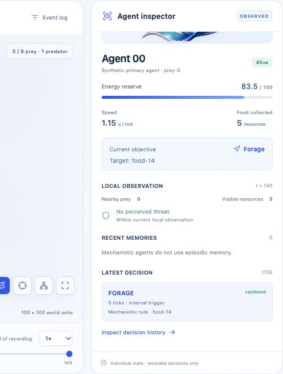

<p align="center">
  
</p>

<h1 align="center">ProtoMind Lab</h1>
<p align="center">
  <strong>A local research environment for collective intelligence and agent decision-making.</strong>
</p>
<p align="center">
  Explore how limited perception, language-model-driven decisions, and individual memory shape behavior in a shared, resource-constrained environment.
</p>

<p align="center">
  
</p>

ProtoMind Lab is an open-source experimental platform for studying **collective behavior under environmental pressure**. It combines a reproducible predator–prey simulation with mechanistic and local language-model policies, then makes the resulting movement, decisions, and measurements accessible through an interactive observatory.

Rather than treating the language model as a physics engine, ProtoMind Lab uses it to select **bounded behavioral objectives**. Movement, perception, energy consumption, resources, and predator interactions remain under the control of the simulation engine. This separation makes the behavior inspectable and supports comparisons across decision policies.

## Explore the observatory

The interface connects the simulation to the evidence behind each experiment. Inspect an individual agent's local observations and recorded decisions, adjust ecological conditions, or compare measurements from previously executed runs.

<table>
  <tr>
    <td width="50%" align="center">
      
    </td>
    <td width="50%" align="center">
      
    </td>
  </tr>
  <tr>
    <td align="center"><sub>Agent inspection — examine observations and decisions.</sub></td>
    <td align="center"><sub>Experiment configuration — create new scenarios with validated parameters.</sub></td>
  </tr>
</table>

**Replay mode** opens with a bundled, verified recording and requires no language model. Explore trajectories, select agents, inspect events, and navigate the timeline at your own pace.

**Live mode** lets you run a new experiment with adjustable population, resource, perception, predator, and decision settings. A calibrated reference configuration remains available for controlled comparisons.

## Research design

The central question is whether **language-model-selected objectives and agent-specific episodic memory** change survival, resource use, or collective motion relative to a mechanistic baseline.

The system follows a clear separation of responsibilities:

```text
Local observation
       ↓
Individual memory (optional)
       ↓
Behavioral policy (mechanistic or local LLM)
       ↓
Validated behavioral objective
       ↓
Mechanistic steering and ecological dynamics
       ↓
Recorded states, events, and measurements
```

The **Python simulation engine** enforces perception boundaries, movement constraints, energy dynamics, resource interactions, and predation. The **TypeScript/PixiJS observatory** renders the recorded or live simulation state independently of the model's inference rate. Local LLM requests are served through **llama.cpp**; agents share model weights while retaining separate observations and memory records.

### Experimental conditions

| Condition | Policy | Memory available to the policy |
| :--- | :--- | :--- |
| **A · Mechanistic** | Deterministic, model-free baseline | None |
| **B · LLM** | Local language model | Current observation only |
| **C · LLM + Memory** | The same local language model | Agent-specific episodic memory |
| **D · Memory Control** | The same local language model | Scrubbed-content memory control |

Condition D retains the structure of memory records while removing their meaningful content; it does **not** exchange authentic memories between agents. Exact definitions and controls are documented in the [experimental protocol](docs/experimental_protocol.md) and [scientific model](docs/scientific_model.md).

The observatory records survival, resource collection, group polarization, fragmentation, predator encounters, and model-specific inference measurements. Descriptive differences are not presented as evidence of a treatment effect without suitable replication and analysis.

## Get started

**Requirements:** Python 3.10+ and macOS or another supported Unix-like environment. macOS is the primary desktop target. Native Windows support is not currently provided.

From the project directory, run:

```bash
./scripts/setup.sh
./scripts/observatory.sh --open
```

The browser interface opens locally, normally at `http://127.0.0.1:8765`. If the port is occupied, use `./scripts/observatory.sh --port 8766 --open`.

**No model download is required** to explore the bundled recording or run mechanistic experiments. Basic setup creates a project-local Python environment; the included production web build does not require Node.js for ordinary use.

On macOS, you can also double-click **`Launch ProtoMind Lab.command`**. To build the local native launcher:

```bash
./scripts/build_macos.sh
```

Open **`ProtoMind Lab.app`** from the project directory after building it. The launcher is ad-hoc signed rather than notarized; first-launch behavior may depend on macOS security settings. Keep the app alongside its project files. See the [installation guide](docs/installation.md) for details.

## Run experiments with a local language model

ProtoMind Lab supports an optional local model backend. The reference integration uses **[Liquid AI LFM3-1.7B](https://huggingface.co/LiquidAI/LFM3-1.7B-GGUF)** in GGUF format, served through llama.cpp.

To install the project-local runtime and download the reference model explicitly:

```bash
./scripts/setup.sh --runtime
./scripts/download_model.sh
```

The download script verifies the pinned Q4_K_M model file against its publisher checksum and reuses a valid existing copy. The model download is approximately 1.1 GB. **Model weights are not included in this repository.**

The **Models** view can import other local GGUF files and inspect their configuration, but compatibility depends on the installed runtime, chat template, and validated structured-decision interface. The application does not assume that every GGUF model will work. Failed model loading does not silently switch an LLM experiment to mock inference.

Choose **Live Mode**, select a scenario and experimental condition, then adjust the available parameters to start a new run. Mechanistic experiments remain available without any language model. Additional experiment workflows are covered in the [usage guide](docs/usage.md).

## Reproducibility

The included example is a **mechanistic Predator Pressure recording** (condition A, seed `1001`) with eight initial prey agents and one predator. It contains 141 frames, including the initial state. The recording's checksum and provenance are documented in `recordings/manifest.json`.

Recorded and validated agent actions allow the simulation engine to replay trajectories and events independently of future language-model outputs. A random seed alone does not guarantee identical text-model decisions.

Run the available checks with:

```bash
./scripts/run_tests.sh
PROTOMIND_HTTP_TEST=1 ./scripts/run_tests.sh

# Optional: requires the installed local model and runtime
PROTOMIND_REAL_TEST=1 ./scripts/run_tests.sh
```

The scientific and engineering documentation provides further detail on the [research design](docs/research_design.md), [model implementation](docs/scientific_model.md), and [limitations](docs/limitations.md).

## Scientific foundations and limitations

ProtoMind Lab draws on foundational work in distributed flocking and collective decision-making, including [Reynolds (1987)](https://doi.org/10.1145/37401.37406) and [Couzin et al. (2005)](https://pubmed.ncbi.nlm.nih.gov/15690039/). These studies inform the modeled mechanisms; they do not constitute empirical validation of this implementation.

The environment uses simplified motion and ecological rules. Its synthetic entities are abstract visual representations, not cell or animal models. LLM-generated objectives are **not evidence of cognition**, and external episodic memory is **not model-weight learning**. Observed group motion does not by itself establish emergent intelligence or an advantage over mechanistic agents. Experimental conclusions depend on adequate replication, appropriate controls, and the limits described in the [research documentation](docs/limitations.md).

## Local by design

ProtoMind Lab requires **no account, cloud inference service, subscription, or telemetry**. Models, generated experiments, caches, logs, and application-managed data remain within the project directory. Operating-system and browser-managed behavior is outside this guarantee.

The source distribution excludes model weights, inference binaries, virtual environments, local databases, and private experiment records. Before publication, run:

```bash
./scripts/prepublish_check.sh --source-only
```

The [publication manifest](publication-manifest.json) and [privacy documentation](docs/privacy_and_storage.md) describe the distribution boundary and local-storage approach.

## Licensing and attribution

Project source code is distributed with the existing [MIT license](LICENSE), subject to the repository owner's confirmation that it covers all newly authored components. LFM3 model weights are governed separately by the [LFM Open License v1.0](https://huggingface.co/LiquidAI/LFM3-1.7B-GGUF/blob/main/LICENSE). Visual-asset provenance and other software notices are recorded in [asset attribution](assets/ATTRIBUTION.md) and [third-party notices](web/THIRD_PARTY_NOTICES.txt).

---

<p align="center">
  <sub>Developed by <a href="https://github.com/altanulaszohre">Altan Ulaş Zöhre</a> · ProtoMind Lab</sub>
</p>
